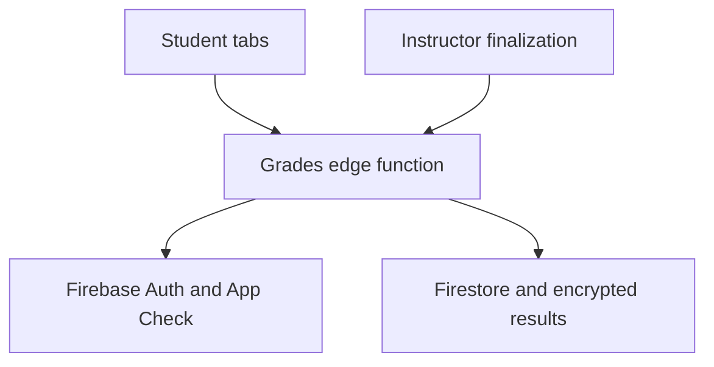

# Activities, semester grading and private grade reveal

## Scope and policy

This implements the exact formula and numerical scale supplied for this project.
It is named `ssu-configured-50-base-v2`; it is not represented as a verified
universal CHED mandate. SSU publishes its handbook at
https://ssu.edu.ph/student-handbook/, but the retrieved landing page alone does
not establish this exact transmutation table or syllabus component weights.
Confirm the applicable department/subject policy with your adviser or registrar
before using this for official academic records.

For each category, pool the student's valid points and maximum points:

```text
categoryRatio = totalEarnedInCategory / totalMaximumInCategory
weightedRawPercentage = sum(categoryRatio × configuredCategoryWeight)
transmutedPercentage = (weightedRawPercentage × 0.5) + 50
```

Categories are Activity, Quiz, Unit Test (`unit_test`), Assignment, and Exam. Weights are percentages totaling 100. Older four-category requests default Unit Test to 0%. Create Unit Test assessments using the assessment type selector; existing quizzes and exams are not automatically reclassified. Deploy the updated `semester-grades` function before using the new category in Flutter. The UI starts with zero weights and
requires the instructor to enter syllabus weights. It does not invent an SSU
default. Categories with no work should have zero weight; a nonzero empty
category produces INC. One low-point task is not weighted equally with a
high-point task merely because each is one task.

| Transmuted percentage (unrounded) | Grade | Result / supplied description |
| --- | --- | --- |
| 99 to 100 | 1.00 | Passed / Excellent |
| 96 to below 99 | 1.25 | Passed |
| 93 to below 96 | 1.50 | Passed / Very Good |
| 90 to below 93 | 1.75 | Passed |
| 87 to below 90 | 2.00 | Passed / Good |
| 84 to below 87 | 2.25 | Passed |
| 81 to below 84 | 2.50 | Passed / Satisfactory |
| 78 to below 81 | 2.75 | Passed |
| 75 to below 78 | 3.00 | Passed |
| Below 75 | 5.00 | Failed |
| Incomplete / dropped | INC / DRP | Incomplete / Dropped |

Thresholds use the unrounded result, so 98.999 is 1.25. The preview displays
four decimal places. A raw 50% becomes 75% and passes under the requested
formula; a genuine graded zero becomes 50% and fails. Pending grades do not
become zero accidentally.

## Architecture



Flutter handles presentation and temporary reveal state. The `semester-grades`
Supabase function owns computation, credential verification, encryption and
publication. Firebase authenticates the existing account; Supabase Auth is not
used to replace the Firebase login. All responses set `Cache-Control: no-store,
private`. Passwords, grade payloads and tokens are never logged.

## Student interface

The desktop navigation contains **Activities & Scores** and **Posted Grades**.
On smaller screens open **More**; both are separate destinations. Existing
navigation indexes remain intact.

**Activities & Scores** uses a paginated, horizontally scrollable data table:
title, subject, type, submitted date/time, total points, earned points, raw score
percentage and status. Subject and type dropdowns filter locally. Pending
earned points and percentages are blank; graded zero remains zero. Late is
shown separately from grading status. Old quiz scores are displayed as Reported,
with an instructor-review note, rather than being presented as trusted grades.
Lists come from queries bound to the
authenticated UID, not from a student ID supplied by the browser.

**Posted Grades** loads only metadata for the student's enrolled subjects and
selected semester. Every row begins `Grade: [ Hidden ]`. A posted subject gets
its own Reveal Grade button; an unposted subject shows Not posted yet. No final
grade value or encrypted blob is returned by this list request. It is not a CSS
mask over preloaded grade text.

Reveal opens a modal requiring Student ID and Account Password. The backend:

1. Verifies Firebase ID token, App Check and active/verified student profile.
2. Counts the attempt against the current UID (10 attempts per 10 minutes;
   successful reveals reset the counter).
3. Matches the supplied campus ID to that UID's profile; looks up its real
   Firebase Auth email privately.
4. Verifies the password with Firebase `signInWithPassword`, requiring the
   returned UID to match and rejecting unfinished MFA.
5. Fetches only the grade document derived from course, term and caller UID.
6. Decrypts with the server key and authenticated owner/term/revision context,
   then returns that grade and Passed/Failed/Incomplete/Dropped result only.

Invalid credentials produce `Invalid Student ID or Password`. No custom login
token, contact email or alternate student's identity is returned. The password
field is obscured and cleared after every attempt. A revealed grade remains
only in the page's memory; Hide, refresh, term changes, app backgrounding and
logout/disposal clear it. Refresh always starts locked again. A user can of
course read a grade they intentionally revealed; this does not prevent photos
or screenshots of an authorized reveal.

## Instructor interface and workflow

Open **Grading > calculator icon**, or **Course > Section > calculator icon**.

1. Select owned subject and active section; academic year and semester come
   from the course already stored in Firestore.
2. Enter the four category weights, totaling 100%.
3. Select missing-work policy: INC (default), or explicitly count unsubmitted
   work as zero. A submitted response still awaiting grading produces INC
   under either choice.
4. If applicable, review old quiz scores against records and explicitly check
   **I reviewed legacy quiz scores**. Older `quiz_attempts` scores were posted
   by the client and cannot be independently recomputed from their score-only
   schema. They are never silently trusted as final grades. The checkbox is an
   instructor attestation; it does not repair the historical score provenance.
5. Compute Preview. Review names, student IDs, raw %, transmuted %, final grade
   and missing requirements. Use Grade status for an explicit INC/DRP with a
   reason, then recompute the preview.
6. Click **Compute & Finalize Semester Grades** and confirm posting.

The backend rereads sources and enrollment in a Firestore transaction. A hash
must match the exact preview, including weights, sources and dispositions; stale
previews are rejected. A single transaction publishes up to 100 students per
section, versioned encrypted revisions, policy metadata and value-free grade
notifications. A retry of the same snapshot does not publish duplicate revisions
or notifications. Corrections require a fresh preview and create a new revision.

Work is included only when its definition is published/closed, course-wide or
in the selected section. Draft work and other sections are excluded. Linked
modern/legacy definitions are deduplicated. `summative` is treated as exam.
Latest submitted attempts take precedence; a newer pending response cannot be
replaced silently with an older graded response. Invalid scores, changed score
maxima and unreviewed legacy quizzes produce INC, not a fabricated average.
All published work for the course/section counts, including future-due work:
finalization is an explicit end-of-semester instructor action.

## Data model

Existing sources remain authoritative; no bulk migration is performed.

| Collection | Purpose |
| --- | --- |
| `courses` | Subject title/code, owner, academicYear, semester, original classCode |
| `enrollments` | courseId/studentId, active membership and sectionId; legacy missing sections use classCode |
| `assessments`, `assignments`, `quizzes` | Work definitions, category and maximum points |
| `assessmentSubmissions`, `submissions`, `quiz_attempts` | Existing score/submission sources |
| `semesterGrades/{hash(courseId,termId,uid)}` | Server-only posted metadata, encrypted result, revision and sourceHash |
| `semesterGrades/{id}/revisions/{revision}` | Immutable server-written encrypted posting revisions |
| `semesterGradePolicies/{hash(courseId,sectionId,termId)}` | Posted weights, missing policy, legacy-review attestation, policyVersion and sourceHash |
| `gradeRevealAttempts/{uid}` | Server-only rate-limit counter and expiry |
| `settings/academicCalendar` (optional) | `currentTermId`, e.g. `2026-2027\|1st Semester` |

Without a configured academicCalendar, the student selector defaults to the
latest academic-year/semester among that student's enrolled subjects. It does
not guess the current semester from the calendar month. A registrar/admin can
set `currentTermId` to the exact `academicYear + '|' + semester` value. No new
composite indexes are needed by the single-field queries introduced here.

Example stored record (values are illustrative):

```json
{
  "studentId": "firebase-uid",
  "courseId": "course-id",
  "sectionId": "IT101-SECTION-A",
  "termId": "2026-2027|1st Semester",
  "posted": true,
  "revision": 1,
  "encrypted": { "version": 1, "iv": "base64-nonce", "ciphertext": "base64-authenticated-ciphertext" }
}
```

Final grade, raw/transmuted percentages, components and dispositions are inside
AES-256-GCM ciphertext. The key lives only in Supabase secrets. Authentication
data binds ciphertext to document ID, UID, term and revision, preventing a blob
from being copied to another student's result. Firestore client rules deny
direct reads/writes even to the owner; therefore Firebase login alone cannot
bypass the reveal password check. This key is not derived from the student's
password, so password resets do not make grades unreadable.

Dart models are in `lib/models/gradebook_models.dart`. `PostedSubject` has no
grade field. `RevealedGrade` is populated only from a successful reveal.

```dart
final api = SemesterGradesService();
final work = await api.request('activities');
final subjects = await api.request('posted'); // Metadata only.
// Only the secure modal sends the entered credentials:
final revealed = await api.request('reveal', {
  'courseId': subject.courseId,
  'termId': subject.termId,
  'campusId': enteredStudentId,
  'password': enteredPassword,
});
```

## Setup and deployment (PowerShell)

The function reuses existing `FIREBASE_SERVICE_ACCOUNT_JSON` and
`FIREBASE_WEB_API_KEY` secrets. One new secret is required:
`SEMESTER_GRADE_ENCRYPTION_KEY` (32 cryptographically random bytes, base64).

```powershell
cd C:\caslms-main
.\scripts\configure-semester-grade-key.ps1
.\scripts\deploy-semester-grades.ps1
.\scripts\build-vercel.ps1
npx.cmd vercel deploy --prebuilt
```

The key script checks for an existing server key first and preserves it. When
initializing, it creates `.env.semester-grades.local` as a private local backup,
excluded by the existing `.env*` git rule, and uploads it using `--env-file`.
It never prints the key or puts it in command history. Back up this file in a
private secure location. Losing or overwriting the server key without migrating
the encrypted records makes existing final grades unreadable. Do not put it in
public Flutter configuration, source control or Vercel frontend variables.

The deployment script deploys the function with gateway JWT validation off
because the function validates Firebase tokens itself, then deploys Firestore
rules. The new explicit server-only rules reinforce existing default-deny
behavior and do not change access to existing raw score collections.

Allow the preview hostname on reCAPTCHA as before. Test posting on a test course
and revealing from two separate student accounts before promoting the preview.
No production deployment or key initialization was performed by the coding task.

## Checks

Local validation completed: targeted Dart analysis has no issues; backend type
checking passed; 13 computation/encryption/password checks and 26 local Firestore
access checks passed. Flutter widget privacy tests were added and analyzed, but
execution was blocked by this workspace's inability to open
`C:\flutter\bin\cache\lockfile`. Run those tests in your own PowerShell terminal
before deployment. Real Firebase password verification and posting/reveal still
need preview acceptance testing with test accounts.

```powershell
deno test --no-config supabase/functions/semester-grades/engine_test.ts supabase/functions/semester-grades/crypto_test.ts supabase/functions/campus-login/verify_password_test.ts
flutter test test/posted_grades_privacy_test.dart
# With the local Firestore emulator running with firestore.rules:
$env:FIRESTORE_EMULATOR_HOST = '127.0.0.1:8189'
node test/firestore_school_rules.mjs
```

End-to-end acceptance: two students see only their own subject rows; no grade
appears in the initial metadata/network response; wrong credentials leave it
locked; correct credentials reveal only the requested own grade; refreshing
hides it; a classmate's UID cannot be used as a reveal target; another instructor
cannot finalize the course; changing a source score invalidates an old preview;
INC/DRP and a legitimate graded zero remain distinct. Test real Firebase
credentials and email-migrated campus-ID accounts on the preview.
